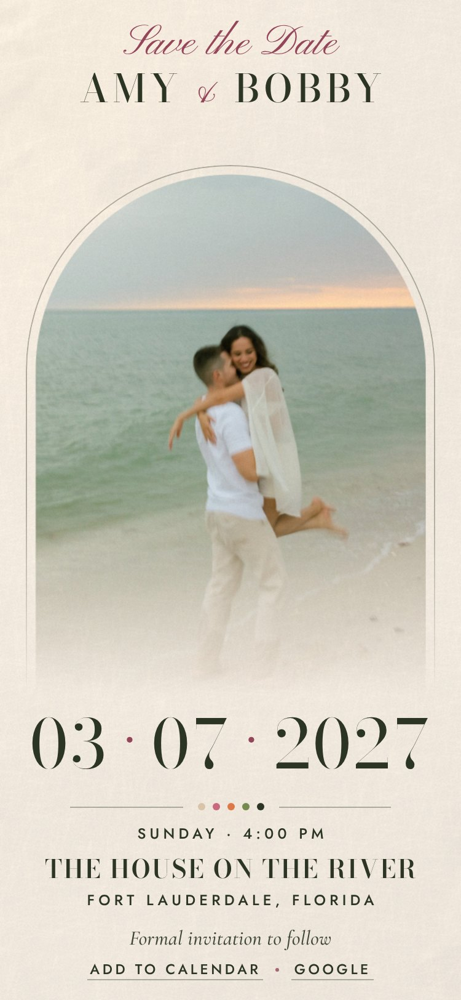

# Save the Date

Amy & Bobby's save-the-date, live at https://amyandbobby.github.io/. A single screen on phone and desktop that opens with a short Three.js intro and settles on the card.

| Page | Design |
| --- | --- |
| [`index.html`](index.html) | **The save-the-date guests receive** at https://amyandbobby.github.io/ — floral, in sand, dusty rose, terracotta, sage and olive. 3D petals blow in and gather into a wreath around the names and date, then part as the beach photo paints in and the text settles into place. |
| [`floral.html`](floral.html) | Forwards to the main address, so older links keep working. |
| [`noir.html`](noir.html) | The black & white alternate. Not linked from the site. |



## Preview locally

The pages load their photos as WebGL textures, so open them through a local server rather than straight from disk:

```bash
python3 -m http.server 8420
```

Then visit http://localhost:8420/.

Two URL options help when checking the intro: `?skip=1` shows the finished card straight away, and `?t=3.5` freezes the intro at 3.5 seconds.

## Edit the details

The names, date, venue and calendar event live in the `CONFIG` block near the top of each page's first script. Change them there.

The couple's photo is `assets/amy-bobby-bw.jpg` (black & white, cropped close on the couple) and `assets/amy-bobby.jpg` (floral, full colour). To use a different photo, replace those files (3:4, 1356 × 1808) or point `CONFIG.photo` at a new file. The other images in `assets/` are AI-generated spares from the original template.

## Publish

Any static host works (Netlify, Vercel, Cloudflare Pages, or GitHub Pages, which needs a paid GitHub plan for a private repository). Before sharing:

- Make the `og:image` and `twitter:image` tags absolute, and set `og:url`, so link previews show the card. Both pages mark the spot with a comment.
- Opened normally, "Add to calendar" downloads an `.ics` file. Inside a frame (an embed or a shared preview), where downloads are blocked, it opens Google Calendar instead.

Both pages respect `prefers-reduced-motion` and fall back to the plain card if WebGL or the CDN is unavailable.
